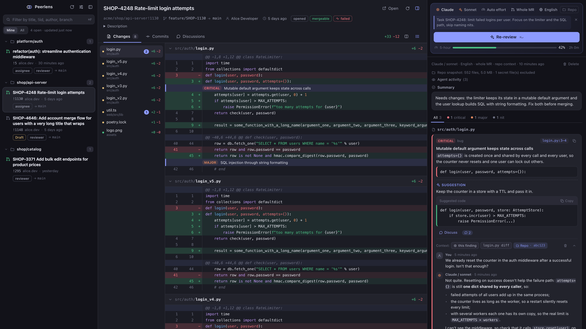

# Peerlens

A small, fast desktop app for reviewing your GitLab merge requests with an AI agent that runs **locally** and
**cannot change anything**. It uses [Claude Code](https://docs.anthropic.com/en/docs/claude-code) or
[Codex](https://github.com/openai/codex) through their CLIs and your existing subscription. It talks to GitLab only
through [`glab`](https://gitlab.com/gitlab-org/cli), and only with read requests.



## Features

- **Your MRs in one place.** *Mine* shows open MRs where you are assignee or reviewer; *All* shows recently updated
  open MRs in your groups (or one group set in Settings). Grouped by project, with filter, draft and role badges.
  Lists load on start and on Refresh, and switching between Mine and All shows the last loaded list instantly.
  Nothing polls in the background.
- **Fast diff viewer.** Virtualized unified or split (side-by-side) diff with syntax highlighting (languages load on
  demand), sticky file headers, pinned line numbers, collapsed large or generated files.
- **Commits and discussions.** Per-commit diffs, threads with resolved filter, jump from a comment to its line,
  GitLab Markdown and emoji rendered safely.
- **AI review.** Pick the agent, model, reasoning effort, scope and language from one compact line. The verdict
  summary sits on top; findings stream in with severity, explanation, the problematic snippet and a suggested fix
  with a Copy button. They are grouped by file, shown inline in the diff and can be filtered by severity. Large MRs
  are reviewed file by file; lock, binary and generated files are skipped and listed.
- **Hand a finding to your coding agent.** The copy icon on each finding copies it as Markdown: file and lines,
  explanation, code, the suggested fix and the whole discussion, with a reminder to verify it before changing code.
- **Reviewer notes.** Tell the agent what the change is about and what to focus on or skip, or paste the task with
  its acceptance criteria: the agent checks the change against them. Pasted text (e.g. from Jira) is cleaned of
  extra indentation and blank lines so it doesn't eat the limit. Notes are kept per MR and sent as a separate
  trusted block; the MR description is already included.
- **Discuss a finding.** Open a thread under any finding and argue with the agent about it. It sees the finding, the
  diff of its file, the thread and (with Repo on) the repository at the reviewed commit. It answers with its decision
  first (still valid, downgraded, withdrawn) and checks fixes you propose. Threads are saved with the review.
- **Optional repo context.** The agent can read a read-only snapshot of the repository at the MR head
  to check callers, definitions and tests. Finding discussions can read the same snapshot (the reviewed commit).
  Snapshots stay in a local cache (2 GB by default, least recently used removed first, unused ones after 14 days).
- **Editable review prompt.** Change what the reviewer checks in Settings, or reset to the built-in prompt. The
  security rules and output format always stay.
- **Usage guard for Claude.** One review at a time, an hourly cap, a pause between parts, and an automatic stop when
  your plan usage reaches a threshold (shown in the panel).
- **Saved reviews.** The last review per MR is kept on disk. It is marked "stale" when the MR gets new commits, and
  you can delete it.
- **In-app updates.** Settings → Updates → Check for updates shows the changelog and installs the new version
  with one click (signed and verified). Peerlens never checks in the background.
- Dark and light themes, keyboard shortcuts, and a small footprint: about 4 MB binary and ~0% CPU when idle.

<details><summary>Light theme, split diff</summary>


</details>

## Requirements

- macOS (Apple Silicon or Intel) or Linux (x86_64; AppImage, .deb or .rpm). Linux support is new: please report issues.
- [`glab`](https://gitlab.com/gitlab-org/cli), logged in (`glab auth login`). Self-hosted GitLab works via Settings → Host.
- At least one agent CLI, logged in:
  - Claude Code: `claude` (subscription or API key)
  - Codex: `codex` (`codex login`)

Binaries are found on `PATH`, in common install locations (`/opt/homebrew/bin`, `/usr/local/bin`, `~/.local/bin`, …)
or via your login shell. You can also set their paths in Settings.

## Install

Download a package from [Releases](../../releases).

**macOS:** pick the `.dmg` for your Mac: `aarch64` for Apple Silicon (M1 and later), `x64` for Intel. Drag Peerlens to
Applications. The builds are not signed or notarized by Apple yet, so the first launch shows *"Apple could not verify
Peerlens…"*. Allow it once:

1. Click **Done**.
2. Open **System Settings → Privacy & Security**, scroll down to **Security** and click **Open Anyway** next to
   *"Peerlens" was blocked*. Confirm with your password or Touch ID, then click **Open**.

After that Peerlens starts normally, and in-app updates don't ask again.

Prefer the terminal? Remove the quarantine flag from the downloaded `.dmg` **before** opening it (macOS doesn't let
a terminal change apps that are already in `/Applications`):

```sh
xattr -d com.apple.quarantine ~/Downloads/Peerlens_*_aarch64.dmg   # or _x64.dmg
```

If macOS says *"Peerlens is damaged"*, you have a build from before v0.1.0 was fixed: download it again from the
latest release.

**Linux (x86_64):**

```sh
# AppImage: works on most distributions
chmod +x Peerlens_*_amd64.AppImage && ./Peerlens_*_amd64.AppImage

# Debian / Ubuntu
sudo apt install ./Peerlens_*_amd64.deb

# Fedora / RHEL / openSUSE
sudo dnf install ./Peerlens-*.x86_64.rpm
```

The `.deb` and `.rpm` pull in WebKitGTK 4.1 automatically. The AppImage needs it installed
(`libwebkit2gtk-4.1-0` on Debian/Ubuntu, `webkit2gtk4.1` on Fedora).

**Updating:** Settings → Updates → **Check for updates**, then **Update & restart**. This works for the macOS app,
the AppImage, `.deb` and `.rpm` (the last two ask for your password to install). Builds made from source link to
the download page instead.

**From source:**

```sh
pnpm install
pnpm tauri build    # macOS: .app + .dmg, Linux: AppImage + .deb + .rpm, in src-tauri/target/release/bundle/
```

Build requirements: Rust (stable, 1.82+), Node.js 20.19+, pnpm. On Linux also the WebKitGTK development packages
(see the [Tauri prerequisites](https://v2.tauri.app/start/prerequisites/#linux)).

## How a review works

1. Peerlens fetches the MR details and diff again (GET), so findings match the exact head commit.
2. Binary, lock and generated files are skipped. Above the size limit, the review runs one file at a time.
3. The agent runs in a fresh, empty temporary folder with the diff and MR metadata as input:
   - Claude Code: no tools at all (or read-only `Read/Grep/Glob` inside the snapshot with repo context).
   - Codex: read-only, offline sandbox; command execution is disabled unless repo context is on.
   - Git, GitLab and GitHub credentials are removed from its environment.
4. The agent answers in a strict JSON-lines format. Peerlens parses it tolerantly, checks that each finding's lines
   exist in the diff, and falls back to showing the raw text if nothing parses.
5. Nothing is applied, committed or posted. The result is text in the panel.

See [SECURITY.md](SECURITY.md) for the full security model and its limitations.

## Settings

| | macOS | Linux |
|---|---|---|
| Settings | `~/Library/Application Support/peerlens/settings.json` | `~/.config/peerlens/settings.json` |
| Saved reviews | `~/Library/Application Support/peerlens/reviews/` | `~/.local/share/peerlens/reviews/` |
| Repo snapshots | `~/Library/Caches/peerlens/snapshots/` | `~/.cache/peerlens/snapshots/` |

| Setting | Default |
|---|---|
| Theme | Dark (Light, System) |
| Default agent / Claude model / effort | Claude Code / Sonnet / Auto |
| Default Codex model | Codex's own default |
| Review language | English |
| Review prompt | Built-in (editable, with reset) |
| Review file by file above | 120,000 bytes of diff |
| Agent timeout | 900 s per part |
| Pause when Claude usage reaches | 80% |
| Max reviews per hour / agent runs per review / pause between parts | 20 / 25 / 3 s |
| Repo context archive limit | 300 MB |
| Repo snapshot cache | 2 GB (Settings → Repo context → Clear empties it) |
| Never unpack (repo context) | `.env*`, `*.pem`, `*.key`, `*secret*`, `*credential*`, … |
| GitLab host, group for "All", binary paths | glab's default host; all your groups; auto-detect |

## Shortcuts

On Linux use Ctrl instead of ⌘.

| Keys | Action |
|---|---|
| ⌘R | Refresh merge requests |
| ⌘F | Filter merge requests (Esc clears) |
| ⌘1 / ⌘2 / ⌘3 | Changes / Commits / Discussions |
| ⌘↵ | Start review |
| ⌘B / ⌘J | Toggle the MR sidebar / the review panel |
| ⌘, | Settings |
| Shift + wheel | Scroll the diff sideways (trackpad swipes work too; in split view both sides move together) |

## Development

```sh
pnpm install
pnpm tauri dev                      # app with hot reload
pnpm dev                            # UI only: open http://localhost:1420/dev/mock.html (fake data, no GitLab/agent)
pnpm check                          # Svelte/TypeScript type check

cd src-tauri
cargo test                          # unit + end-to-end tests with fake glab/claude/codex, no network
cargo fmt --check && cargo clippy --all-targets -- -D warnings
```

Opt-in tests against real services (they read your GitLab and use your agent subscription):

```sh
cargo test --test live_glab live_read_flow -- --ignored --nocapture        # GitLab, GET only
cargo test --test live_glab live_claude_review -- --ignored --nocapture    # one cheap Claude review
PEERLENS_CODEX_BIN=$(command -v codex) cargo test --test live_glab live_codex_argv -- --ignored --nocapture
```

Layout:

```
src-tauri/src/
  gitlab/      the only place glab runs (GET-only), API calls, models
  agents/      agent detection, read-only runners for Claude Code and Codex, tolerant output parser
  review/      chunking, prompt, repo snapshot and its cache, saved reviews
  diff.rs      unified diff parser
  platform.rs  OS-specific code (binary lookup, process groups, opening URLs)
src/           Svelte 5 UI (no UI kit; custom diff renderer, Markdown renderer, icons)
fixtures/      fake glab / claude / codex used by tests
dev/           mock backend for working on the UI in a browser
scripts/       app icon source (swift scripts/icon.swift icon.png && pnpm tauri icon icon.png)
```

## Releasing

1. One-time: create the updater signing key and add it to the repository secrets
   (Settings → Secrets and variables → Actions):
   ```sh
   pnpm tauri signer generate -w ~/.tauri/peerlens-updater.key     # keep the key and password safe
   ```
   - `TAURI_SIGNING_PRIVATE_KEY`: contents of `~/.tauri/peerlens-updater.key`
   - `TAURI_SIGNING_PRIVATE_KEY_PASSWORD`: its password

   Put the public key (`~/.tauri/peerlens-updater.key.pub`) into `plugins.updater.pubkey` in
   `src-tauri/tauri.conf.json`. Losing the private key means installed apps can no longer update themselves.
2. Bump the version, commit, tag and push:
   ```sh
   python3 scripts/release.py bump 0.2.0
   git commit -am "chore: release 0.2.0" && git tag v0.2.0 && git push origin main v0.2.0
   ```
3. The release workflow builds macOS and Linux packages, writes the changelog from the `feat:`/`fix:`/`perf:`
   commits since the previous tag, signs the update bundles and uploads `latest.json` to a **draft** release. Tests
   run once, in parallel with the builds; if they fail, `latest.json` is not uploaded. Check that the run is green,
   review the draft and publish; installed apps see the update only after that.

## Roadmap

GitHub support, optional auto-refresh, signed and notarized macOS builds, Linux ARM builds.

## License

[MIT](LICENSE)
