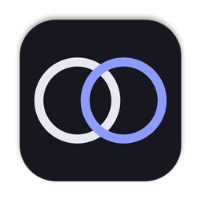
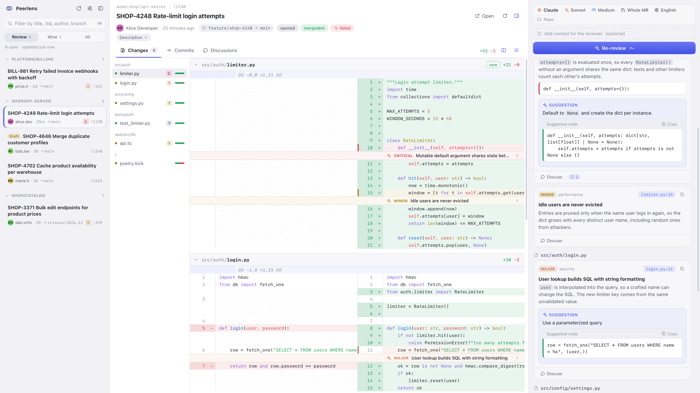
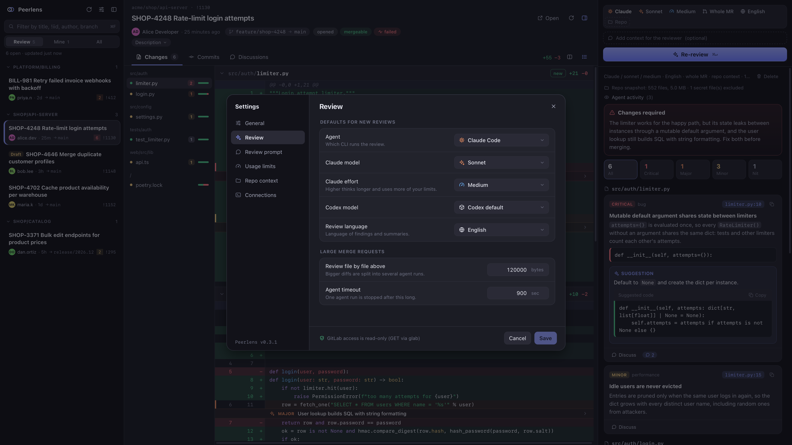

<div align="center">



# Peerlens

**Review GitLab merge requests with an AI agent that runs on your machine and can't change anything.**

[](https://github.com/dvxzr/Peerlens/releases/latest)
[](https://github.com/dvxzr/Peerlens/actions/workflows/ci.yml)
[](LICENSE)


[Install](#install) · [Features](#features) · [How it works](#how-a-review-works) · [Security](SECURITY.md) · [Development](#development)

</div>


Peerlens is a small, fast desktop app for the merge requests you review. It runs
[Claude Code](https://docs.anthropic.com/en/docs/claude-code) or [Codex](https://github.com/openai/codex) through
their CLIs and your existing subscription, and talks to GitLab only through [`glab`](https://gitlab.com/gitlab-org/cli)
with read requests. Nothing is committed, applied or posted: findings stay in the app until you act on them.

## Features

**Merge requests**
- **Review / Mine / All.** MRs where you are a reviewer, MRs assigned to you, or recently updated open MRs in your
  groups (or one group set in Settings). Grouped by project, with filter, author, target branch and a findings badge.
  Lists load on start and on Refresh; nothing polls in the background.
- **Fast diff viewer.** Virtualized unified or split diff, syntax highlighting loaded on demand, files grouped by
  folder, sticky file headers, collapsed large or generated files.
- **Commits and discussions.** Per-commit diffs and GitLab threads with a resolved filter; jump from a comment to its
  line. GitLab Markdown and emoji are rendered safely.

**AI review**
- **One line of options.** Agent, model, reasoning effort, scope (whole MR or one file) and review language.
- **Findings where the code is.** Each finding has a severity, explanation, the problematic snippet and a suggested
  fix. Findings appear as slim strips under their lines in the diff and as cards in the panel, with a verdict on top
  and severity counters that double as filters.
- **Reviewer notes.** Tell the agent what the change is for and what to focus on, or paste the task with its
  acceptance criteria. Pasted text is cleaned of extra indentation; notes are kept per MR.
- **Discuss a finding.** Argue with the agent in a thread under any finding. It answers with its decision first
  (still valid, downgraded, withdrawn) and checks fixes you propose. Threads are saved with the review.
- **Hand it to your coding agent.** Copy a finding as Markdown: file, lines, explanation, code, suggested fix and
  the discussion, with a reminder to verify before changing code.
- **Optional repo context.** Let the agent read a read-only snapshot of the repository at the MR head to check
  callers, definitions and tests. Snapshots are cached locally (2 GB by default, least recently used removed first).
- **Large MRs.** Reviewed file by file above a size limit; lock, binary and generated files are skipped and listed.

**Everyday use**
- **Editable review prompt** with a reset to the built-in one; security rules and the output format always stay.
- **Usage guard for Claude:** one review at a time, an hourly cap, a pause between parts and an automatic stop near
  your plan limits.
- **Saved reviews.** The last review per MR is kept on disk and marked *stale* when the MR gets new commits.
- **In-app updates** with changelog and signature check, only when you ask.
- Dark, light and system themes, keyboard shortcuts, about 4 MB binary and ~0% CPU when idle.

<table>
  <tr>
    <td width="50%"></td>
    <td width="50%"></td>
  </tr>
  <tr>
    <td align="center"><sub>Light theme, split diff</sub></td>
    <td align="center"><sub>Settings</sub></td>
  </tr>
</table>

## Install

Download a package for your system from the [latest release](https://github.com/dvxzr/Peerlens/releases/latest).

**Requirements**
- macOS (Apple Silicon or Intel) or Linux x86_64.
- [`glab`](https://gitlab.com/gitlab-org/cli), logged in with `glab auth login`. Self-hosted GitLab works via
  Settings → Connections → Host.
- At least one agent CLI, logged in: Claude Code (`claude`, subscription or API key) or Codex (`codex login`).

Binaries are found on `PATH`, in common install locations (`/opt/homebrew/bin`, `/usr/local/bin`, `~/.local/bin`, …)
or through your login shell. You can also set their paths in Settings.

<details>
<summary><b>macOS</b></summary>

Pick the `.dmg` for your Mac (`aarch64` for Apple Silicon, `x64` for Intel) and drag Peerlens to Applications.
The builds are not signed or notarized by Apple yet, so the first launch shows *"Apple could not verify
Peerlens…"*. Allow it once:

1. Click **Done**.
2. Open **System Settings → Privacy & Security**, scroll to **Security** and click **Open Anyway** next to
   *"Peerlens" was blocked*. Confirm, then click **Open**.

After that Peerlens starts normally, and in-app updates don't ask again. Prefer the terminal? Remove the quarantine
flag from the downloaded `.dmg` **before** opening it:

```sh
xattr -d com.apple.quarantine ~/Downloads/Peerlens_*_aarch64.dmg   # or _x64.dmg
```

</details>

<details>
<summary><b>Linux</b></summary>

```sh
# AppImage: works on most distributions
chmod +x Peerlens_*_amd64.AppImage && ./Peerlens_*_amd64.AppImage

# Debian / Ubuntu
sudo apt install ./Peerlens_*_amd64.deb

# Fedora / RHEL / openSUSE
sudo dnf install ./Peerlens-*.x86_64.rpm
```

The `.deb` and `.rpm` pull in WebKitGTK 4.1 automatically. The AppImage needs it installed
(`libwebkit2gtk-4.1-0` on Debian/Ubuntu, `webkit2gtk4.1` on Fedora). Linux support is new: please report issues.

</details>

<details>
<summary><b>From source</b></summary>

```sh
pnpm install
pnpm tauri build    # macOS: .app + .dmg, Linux: AppImage + .deb + .rpm, in src-tauri/target/release/bundle/
```

Requires Rust (stable, 1.82+), Node.js 20.19+ and pnpm; on Linux also the WebKitGTK development packages
(see the [Tauri prerequisites](https://v2.tauri.app/start/prerequisites/#linux)).

</details>

**Updating:** Settings → General → **Check now**, then **Update & restart**. This works for the macOS app, the
AppImage, `.deb` and `.rpm` (the last two ask for your password). Builds made from source link to the download page.

## How a review works

1. Peerlens fetches the MR details and diff again (GET), so findings match the exact head commit.
2. Binary, lock and generated files are skipped. Above the size limit, the review runs one file at a time.
3. The agent runs in a fresh, empty temporary folder with the diff and MR metadata as input:
   - Claude Code: no tools at all (or read-only `Read/Grep/Glob` inside the snapshot with repo context).
   - Codex: read-only, offline sandbox; command execution is disabled unless repo context is on.
   - Git, GitLab and GitHub credentials are removed from its environment.
4. The agent answers in a strict JSON-lines format. Peerlens parses it tolerantly, checks that each finding's lines
   exist in the diff, and falls back to showing the raw text if nothing parses.
5. Nothing is applied, committed or posted. The result is text in the panel.

See [SECURITY.md](SECURITY.md) for the full security model and its limitations.

## Configuration

Everything is set in the app (⌘,). Files live here:

| | macOS | Linux |
|---|---|---|
| Settings | `~/Library/Application Support/peerlens/settings.json` | `~/.config/peerlens/settings.json` |
| Saved reviews | `~/Library/Application Support/peerlens/reviews/` | `~/.local/share/peerlens/reviews/` |
| Repo snapshots | `~/Library/Caches/peerlens/snapshots/` | `~/.cache/peerlens/snapshots/` |

<details>
<summary><b>Defaults</b></summary>

| Setting | Default |
|---|---|
| Theme | Dark (Light, System) |
| Default agent / Claude model / effort | Claude Code / Sonnet / Auto |
| Default Codex model | Codex's own default |
| Review language | English |
| Review prompt | Built-in (editable, with reset) |
| Review file by file above | 120,000 bytes of diff |
| Agent timeout | 900 s per part |
| Pause at Claude usage | 80% |
| Max reviews per hour / agent runs per review / pause between parts | 20 / 25 / 3 s |
| Repo context archive limit | 300 MB |
| Repo snapshot cache | 2 GB (Settings → Repo context → Clear empties it) |
| Never unpack (repo context) | `.env*`, `*.pem`, `*.key`, `*secret*`, `*credential*`, … |
| GitLab host, group for "All", binary paths | glab's default host; all your groups; auto-detect |

</details>

### Keyboard shortcuts

On Linux use Ctrl instead of ⌘.

| Keys | Action |
|---|---|
| ⌘R | Refresh merge requests |
| ⌘F | Filter merge requests (Esc clears) |
| ⌘1 / ⌘2 / ⌘3 | Changes / Commits / Discussions |
| ⌘↵ | Start review |
| ⌘B / ⌘J | Toggle the MR sidebar / the review panel |
| ⌘, | Settings (⌘S saves) |
| Shift + wheel | Scroll the diff sideways (trackpad swipes work too; in split view both sides move together) |

## Development

```sh
pnpm install
pnpm tauri dev                      # app with hot reload
pnpm dev                            # UI only: open http://localhost:1420/dev/mock.html (fake data, no GitLab/agent)
pnpm check                          # Svelte/TypeScript type check

cd src-tauri
cargo test                          # unit + end-to-end tests with fake glab/claude/codex, no network
cargo fmt --check && cargo clippy --all-targets -- -D warnings
```

The README screenshots are taken from `dev/mock.html`, so they show fictional data only.

<details>
<summary><b>Tests against real services</b></summary>

These read your GitLab and use your agent subscription:

```sh
cargo test --test live_glab live_read_flow -- --ignored --nocapture        # GitLab, GET only
cargo test --test live_glab live_claude_review -- --ignored --nocapture    # one cheap Claude review
PEERLENS_CODEX_BIN=$(command -v codex) cargo test --test live_glab live_codex_argv -- --ignored --nocapture
```

</details>

<details>
<summary><b>Project layout</b></summary>

```
src-tauri/src/
  gitlab/      the only place glab runs (GET-only), API calls, models
  agents/      agent detection, read-only runners for Claude Code and Codex, tolerant output parser
  review/      chunking, prompt, repo snapshot and its cache, saved reviews
  diff.rs      unified diff parser
  platform.rs  OS-specific code (binary lookup, process groups, opening URLs)
src/           Svelte 5 UI (no UI kit; custom diff renderer, Markdown renderer, icons)
fixtures/      fake glab / claude / codex used by tests
dev/           mock backend for working on the UI in a browser
scripts/       release helpers and the app icon source (swift scripts/icon.swift icon.png && pnpm tauri icon icon.png)
```

</details>

<details>
<summary><b>Releasing</b></summary>

1. One-time: create the updater signing key and add it to the repository secrets
   (Settings → Secrets and variables → Actions):
   ```sh
   pnpm tauri signer generate -w ~/.tauri/peerlens-updater.key     # keep the key and password safe
   ```
   - `TAURI_SIGNING_PRIVATE_KEY`: contents of `~/.tauri/peerlens-updater.key`
   - `TAURI_SIGNING_PRIVATE_KEY_PASSWORD`: its password

   Put the public key (`~/.tauri/peerlens-updater.key.pub`) into `plugins.updater.pubkey` in
   `src-tauri/tauri.conf.json`. Losing the private key means installed apps can no longer update themselves.
2. Bump the version, commit, tag and push:
   ```sh
   python3 scripts/release.py bump 0.2.0
   git commit -am "chore: release 0.2.0" && git tag v0.2.0 && git push origin main v0.2.0
   ```
3. The release workflow builds macOS and Linux packages, writes the changelog from the `feat:`/`fix:`/`perf:`
   commits since the previous tag, signs the update bundles and uploads `latest.json` to a **draft** release. Tests
   run once, in parallel with the builds; if they fail, `latest.json` is not uploaded. Check that the run is green,
   review the draft and publish; installed apps see the update only after that.

</details>

## Roadmap

GitHub support, optional auto-refresh, signed and notarized macOS builds, Linux ARM builds.

## Contributing

Issues and pull requests are welcome. Please run `pnpm check`, `cargo fmt --check`, `cargo clippy` and `cargo test`
before opening a PR, and report security issues as described in [SECURITY.md](SECURITY.md).

## License

[MIT](LICENSE) © 2026 Artem
